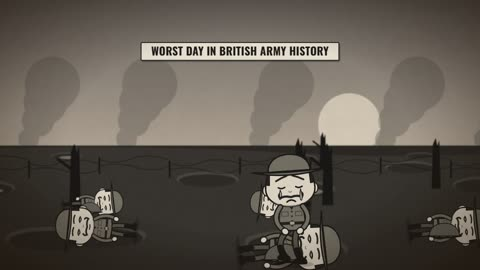
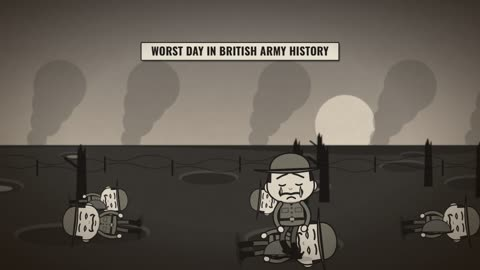

# `aftermath` (action)

**Use it when:** After the battle: 'it was the worst day…', 'the field was covered with dead…', 'by nightfall…'. Quiet, grey.

**Do NOT use it when:** —

**Camera (what the compiler does, per variant):** A: wide of the field (grey) → medium on the survivor. B: close on a helmet on the ground, then the wide.

## Fields

| field | required | value | default | meaning |
|---|---|---|---|---|
| `side` | no | side name |  | whose dead |
| `survivor` | no | true / false | `true` | a survivor walks back through them |

Plus the common fields (`at`, `recipe`, `says`, `variant`, `date`, `place`, `name_card`, `label`, `counter`, `stamp`, `time`, `weather`, `tint`, …) — see [CATALOG.md](CATALOG.md#fields-every-card-can-have).

Variants: A, B (leave `variant` out: the compiler rotates them so the film never repeats a composition).

## Example card

```json
{
 "at": "It's still the worst day",
 "recipe": "aftermath",
 "says": "The first day of the Somme remains the British Army's worst day.",
 "side": "british",
 "label": "WORST DAY IN BRITISH ARMY HISTORY",
 "tint": "grey",
 "time": "dusk"
}
```

## Previews (middle frame of the example, each variant)

Variant A: 
Variant B: 
