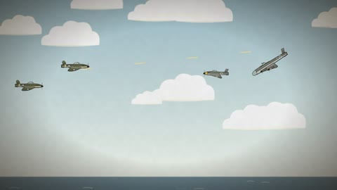
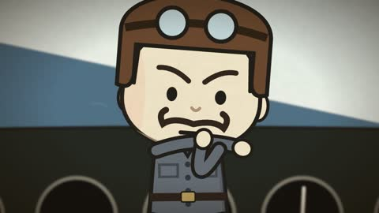

# `air_battle` (action)

**Use it when:** Aircraft fight: 'the RAF fought off…', 'dogfights over…', 'fighters attacked the bombers'.

**Do NOT use it when:** Bombs falling on a city (bombing).

**Camera (what the compiler does, per variant):** A: fighters cross the sky with tracers, one enemy trails smoke and falls. B: the pilot in the cockpit first (close), then the sky.

## Fields

| field | required | value | default | meaning |
|---|---|---|---|---|
| `side` | no | side name |  | first side's fighters |
| `enemy` | no | side name |  | the enemy aircraft |
| `hit_on` | no | words copied from this card's narration |  | word(s) where one is hit |

Plus the common fields (`at`, `recipe`, `says`, `variant`, `date`, `place`, `name_card`, `label`, `counter`, `stamp`, `time`, `weather`, `tint`, …) — see [CATALOG.md](CATALOG.md#fields-every-card-can-have).

Variants: A, B (leave `variant` out: the compiler rotates them so the film never repeats a composition).

## Example card

```json
{
 "at": "Fighters rose to meet them",
 "recipe": "air_battle",
 "says": "British fighters attacked the German bomber formations.",
 "side": "british",
 "enemy": "german"
}
```

## Previews (middle frame of the example, each variant)

Variant A: 
Variant B: 
