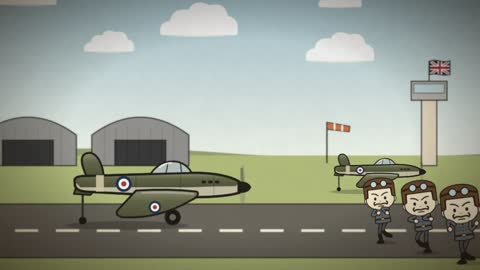

# `airfield` (action)

**Use it when:** Pilots and planes on the ground: 'the squadrons were scrambled…', 'pilots waited…', 'the raid took off'.

**Do NOT use it when:** —

**Camera (what the compiler does, per variant):** A: pilots run past a parked fighter, a plane starts its engine.

## Fields

| field | required | value | default | meaning |
|---|---|---|---|---|
| `side` | no | side name |  | whose airfield |
| `scramble` | no | true / false | `true` | pilots run to the planes |

Plus the common fields (`at`, `recipe`, `says`, `variant`, `date`, `place`, `name_card`, `label`, `counter`, `stamp`, `time`, `weather`, `tint`, …) — see [CATALOG.md](CATALOG.md#fields-every-card-can-have).

Variants: A (leave `variant` out: the compiler rotates them so the film never repeats a composition).

## Example card

```json
{
 "at": "The squadrons were scrambled",
 "recipe": "airfield",
 "says": "RAF pilots ran to their fighters as radar spotted the raid.",
 "side": "british"
}
```

## Previews (middle frame of the example, each variant)

Variant A: 
