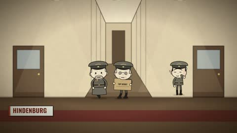
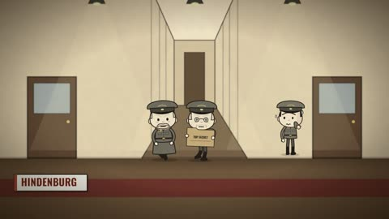

# `approach` (action)

**Use it when:** People on their way to something important: 'the two men went to see the emperor', 'he was summoned', 'the delegates walked in'. Use it with name cards when important people first appear.

**Do NOT use it when:** They have already arrived (interrupt / dialogue / meeting).

**Camera (what the compiler does, per variant):** A: one depth shot — they grow toward the lens (corridor/street), bystander salutes. B: start on their feet/faces close, dissolve to the depth shot.

## Fields

| field | required | value | default | meaning |
|---|---|---|---|---|
| `who` | **yes** | list |  | 1-3 cast ids walking toward the camera (first = left) |
| `setting` | no | one of `corridor`, `street`, `railway`, `station`, `garden`, `hotel`, `airfield`, `dock`, `field`, `snow` | `"corridor"` | where they walk |
| `carry` | no | one of `folder`, `telegram`, `suitcase`, `none` | `"folder"` | what the second person carries |
| `bystander` | no | true / false | `true` | an officer / clerk at the side who salutes or steps aside as they pass |
| `side` | no | side name |  | side of the bystander |
| `mood` | no | one of `neutral`, `worried`, `determined`, `sad`, `shocked`, `angry`, `tired`, `smug`, `happy`, `panic` | `"determined"` | their faces |

Plus the common fields (`at`, `recipe`, `says`, `variant`, `date`, `place`, `name_card`, `label`, `counter`, `stamp`, `time`, `weather`, `tint`, …) — see [CATALOG.md](CATALOG.md#fields-every-card-can-have).

Variants: A, B (leave `variant` out: the compiler rotates them so the film never repeats a composition).

## Example card

```json
{
 "at": "Field Marshal Paul von Hindenburg",
 "recipe": "approach",
 "says": "The two generals stride toward the Kaiser's study with the bad news.",
 "who": [
  "hindenburg",
  "ludendorff"
 ],
 "setting": "corridor",
 "carry": "folder",
 "name_card": "hindenburg",
 "place_id": "spa_hq"
}
```

## Previews (middle frame of the example, each variant)

Variant A: 
Variant B: 
