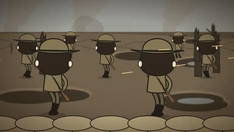
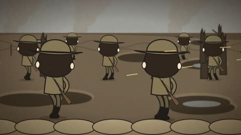

# `assault` (action)

**Use it when:** An attack on foot: 'they went over the top…', 'the infantry attacked…', 'the assault began…', 'attacks gained nothing and cost many men'.

**Do NOT use it when:** A running charge across the frame (wave), defenders pinned down (under_fire), tanks leading (tank_attack).

**Camera (what the compiler does, per variant):** A: from behind the parapet: rows walk away into the smoke, wide → full on the group where men fall. B: the same from a lower angle with a close on one man before he goes, then the wide.

## Fields

| field | required | value | default | meaning |
|---|---|---|---|---|
| `side` | no | side name |  | who attacks |
| `falls` | no | whole number | `2` | how many men are hit (0-5) |
| `hit_on` | no | words copied from this card's narration |  | word(s) where the first man falls (e.g. 'cost', 'killed') |
| `climb` | no | true / false | `true` | the near row climbs out of the trench at the start |
| `shells` | no | whole number | `3` | shell bursts among them (0-6) |
| `mg` | no | true / false | `true` | machine-gun tracers from the enemy line |

Plus the common fields (`at`, `recipe`, `says`, `variant`, `date`, `place`, `name_card`, `label`, `counter`, `stamp`, `time`, `weather`, `tint`, …) — see [CATALOG.md](CATALOG.md#fields-every-card-can-have).

Variants: A, B (leave `variant` out: the compiler rotates them so the film never repeats a composition).

## Example card

```json
{
 "at": "Attacks on the Western Front gained",
 "recipe": "assault",
 "says": "Attacks across no man's land won little ground and killed many men.",
 "side": "british",
 "falls": 3,
 "hit_on": "cost enormous"
}
```

## Previews (middle frame of the example, each variant)

Variant A: 
Variant B: 
