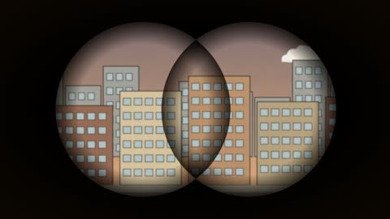

# `binocular_view` (action)

**Use it when:** What someone sees in the distance — right after a card where he raises binoculars (vista / watch_front / decision): 'they were 56 km from Paris', 'the enemy fleet was in sight'.

**Do NOT use it when:** Nobody is looking (use a normal scene of the place).

**Camera (what the compiler does, per variant):** A: the view inside two round lenses, swaying slightly, slow drift across the place.

## Fields

| field | required | value | default | meaning |
|---|---|---|---|---|
| `setting` | no | one of `city`, `street`, `ruins`, `harbor`, `sea`, `field`, `nomansland`, `snow`, `desert`, `airfield` | `"city"` | what is seen |
| `movers` | no | one of `none`, `tanks`, `infantry`, `ships`, `trucks` | `"none"` | what moves in the view |
| `side` | no | side name |  | side of the movers |

Plus the common fields (`at`, `recipe`, `says`, `variant`, `date`, `place`, `name_card`, `label`, `counter`, `stamp`, `time`, `weather`, `tint`, …) — see [CATALOG.md](CATALOG.md#fields-every-card-can-have).

Variants: A (leave `variant` out: the compiler rotates them so the film never repeats a composition).

## Example card

```json
{
 "at": "about fifty-six kilometres",
 "recipe": "binocular_view",
 "says": "Through the binoculars the Germans could see the roofs of Paris.",
 "setting": "city",
 "time": "dusk"
}
```

## Previews (middle frame of the example, each variant)

Variant A: 
