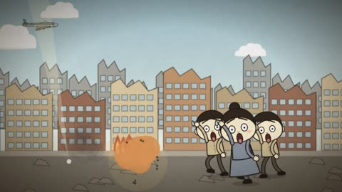
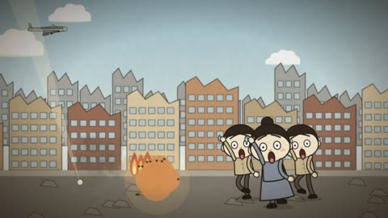

# `bombing` (action)

**Use it when:** Bombs on a city, port or factory: 'the Blitz…', 'Dresden was bombed…', 'bombers struck…'.

**Do NOT use it when:** —

**Camera (what the compiler does, per variant):** A: bombers overhead, bombs falling, bursts in the street, fires (wide) → civilians running. B: civilians look up first (close), then the bursts.

## Fields

| field | required | value | default | meaning |
|---|---|---|---|---|
| `side` | no | side name |  | whose bombers |
| `time` | no | one of `day`, `dusk`, `night` | `"night"` | time |
| `civilians` | no | true / false | `true` | civilians running for shelter |

Plus the common fields (`at`, `recipe`, `says`, `variant`, `date`, `place`, `name_card`, `label`, `counter`, `stamp`, `time`, `weather`, `tint`, …) — see [CATALOG.md](CATALOG.md#fields-every-card-can-have).

Variants: A, B (leave `variant` out: the compiler rotates them so the film never repeats a composition).

## Example card

```json
{
 "at": "Night after night the bombers came",
 "recipe": "bombing",
 "says": "German bombers hit London for months during the Blitz.",
 "side": "german"
}
```

## Previews (middle frame of the example, each variant)

Variant A: 
Variant B: 
