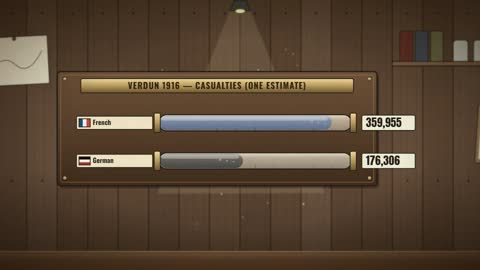

# `chart` (device)

**Use it when:** Two or more numbers must be COMPARED: 'X lost 377,000, Y lost 337,000', 'Britain built twice as many…'. ≤ 7 s.

**Do NOT use it when:** A single number (put a counter on an action card instead).

**Camera (what the compiler does, per variant):** A: glass tubes on a wooden plaque in the workroom fill one by one on their words.

## Fields

| field | required | value | default | meaning |
|---|---|---|---|---|
| `title` | **yes** | text |  | what is compared (CAPITALS) |
| `items` | **yes** | list |  | [{"label": "French", "value": 377000, "side": "french", "on": "phrase"}] 2-5 items |
| `unit` | no | text | `""` | unit after the numbers |

Plus the common fields (`at`, `recipe`, `says`, `variant`, `date`, `place`, `name_card`, `label`, `counter`, `stamp`, `time`, `weather`, `tint`, …) — see [CATALOG.md](CATALOG.md#fields-every-card-can-have).

Variants: A (leave `variant` out: the compiler rotates them so the film never repeats a composition).

## Example card

```json
{
 "at": "One modern calculation",
 "recipe": "chart",
 "says": "Both armies lost over 300,000 men at Verdun.",
 "title": "VERDUN 1916 — CASUALTIES (ONE ESTIMATE)",
 "items": [
  {
   "label": "French",
   "value": 377000,
   "side": "french",
   "on": "French casualties"
  },
  {
   "label": "German",
   "value": 337000,
   "side": "german",
   "on": "German casualties"
  }
 ]
}
```

## Previews (middle frame of the example, each variant)

Variant A: 
