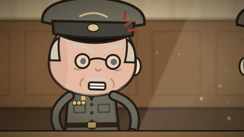
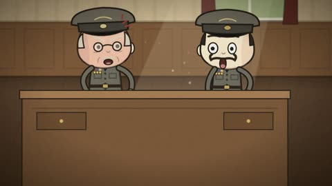

# `confront` (action)

**Use it when:** A demand, an order, an argument that lands hard: 'Germany needed an armistice, immediately', 'he demanded…', 'he refused'. One person forces the point physically (fist on the desk, steps forward); the other recoils.

**Do NOT use it when:** A calm exchange (dialogue).

**Camera (what the compiler does, per variant):** A: two-shot across the desk → dissolve to a medium-close of A as the gesture lands. B: close on B first, A's gesture lands off-centre, then the two-shot.

## Fields

| field | required | value | default | meaning |
|---|---|---|---|---|
| `a` | **yes** | cast id |  | the one who forces the point |
| `b` | **yes** | cast id |  | the one who receives it |
| `hit_on` | no | words copied from this card's narration |  | word(s) where the fist comes down / he steps in |
| `gesture` | no | one of `slam`, `point`, `fist`, `stop` | `"slam"` | the forcing gesture |
| `setting` | no | one of `office`, `study`, `warroom`, `cabinet`, `conference`, `bunker`, `tent`, `radio`, `codebreak`, `hotel`, `home`, `kitchen`, `train_interior`, `bridge` | `"office"` | the room |
| `flag` | no | side name |  | flag on the wall |

Plus the common fields (`at`, `recipe`, `says`, `variant`, `date`, `place`, `name_card`, `label`, `counter`, `stamp`, `time`, `weather`, `tint`, …) — see [CATALOG.md](CATALOG.md#fields-every-card-can-have).

Variants: A, B (leave `variant` out: the compiler rotates them so the film never repeats a composition).

## Example card

```json
{
 "at": "Germany needed an armistice,",
 "recipe": "confront",
 "says": "Ludendorff insists Germany must ask for an armistice at once.",
 "a": "ludendorff",
 "b": "kaiser_wilhelm",
 "hit_on": "immediately",
 "setting": "office",
 "flag": "german",
 "place_id": "kaiser_study"
}
```

## Previews (middle frame of the example, each variant)

Variant A: 
Variant B: 
