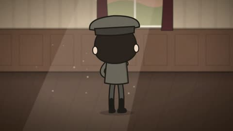

# `contemplate` (action)

**Use it when:** Someone left alone with the news / the weight of a decision: 'he could hardly believe it', 'he knew it was over', 'he never recovered'. Show the body: walking to the window, sitting down slowly, staring out.

**Do NOT use it when:** He reacts in front of others (interrupt / confront).

**Camera (what the compiler does, per variant):** A: full shot, he crosses to the window and stands with his back to us; slow push. B: close on his face first, dissolve to the wide of him alone in the room.

## Fields

| field | required | value | default | meaning |
|---|---|---|---|---|
| `who` | **yes** | cast id |  | the person |
| `action` | no | one of `window`, `sit`, `stare`, `walk_away` | `"window"` | what he does |
| `setting` | no | one of `office`, `study`, `warroom`, `cabinet`, `conference`, `bunker`, `tent`, `radio`, `codebreak`, `hotel`, `home`, `kitchen`, `train_interior`, `bridge`, `deck`, `railway`, `garden`, `nomansland` | `"office"` | where |
| `mood` | no | one of `neutral`, `worried`, `determined`, `sad`, `shocked`, `angry`, `tired`, `smug`, `happy`, `panic` | `"sad"` | his face before he turns away |

Plus the common fields (`at`, `recipe`, `says`, `variant`, `date`, `place`, `name_card`, `label`, `counter`, `stamp`, `time`, `weather`, `tint`, …) — see [CATALOG.md](CATALOG.md#fields-every-card-can-have).

Variants: A, B (leave `variant` out: the compiler rotates them so the film never repeats a composition).

## Example card

```json
{
 "at": "The Kaiser could hardly",
 "recipe": "contemplate",
 "says": "The Kaiser is left stunned by the news that the war is lost.",
 "who": "kaiser_wilhelm",
 "action": "window",
 "setting": "office",
 "time": "dusk",
 "tint": "cold",
 "place_id": "kaiser_study"
}
```

## Previews (middle frame of the example, each variant)

Variant A: 
Variant B: 
