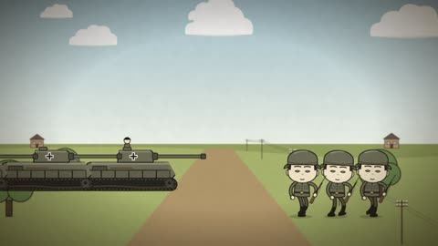
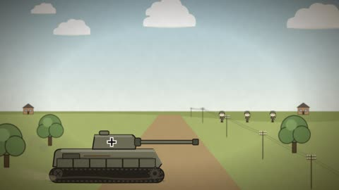
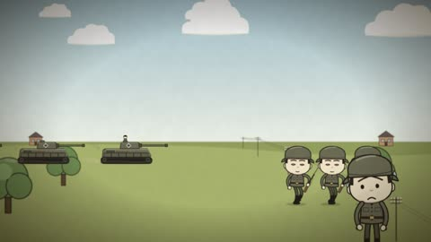

# `convoy` (action)

**Use it when:** Vehicles move: 'the tanks rolled…', 'supplies were trucked…', 'the panzers raced to the coast…'.

**Do NOT use it when:** A single vehicle arrives somewhere (use vehicle in a scene), aircraft (air_battle/bombing), ships (naval_battle).

**Camera (what the compiler does, per variant):** A: column on the middle road, wide, then a closer pass. B: a close pass that fills half the frame (low, slight shake) with infantry far behind. C: three planes — column far, infantry mid, one soldier near.

## Fields

| field | required | value | default | meaning |
|---|---|---|---|---|
| `side` | no | side name |  | whose vehicles |
| `vehicle` | no | one of `tank`, `tank_heavy`, `truck`, `halftrack`, `jeep`, `car`, `artillery`, `horse`, `cart` | `"tank"` | which vehicle (tank = the side's usual tank for the era) |
| `count` | no | whole number | `3` | 2-4 vehicles |
| `setting` | no | one of `polder`, `field`, `countryside`, `steppe`, `snow`, `desert`, `mud`, `street`, `ruins`, `nomansland` | `"polder"` | landscape |
| `direction` | no | one of `right`, `left` | `"right"` | which way |
| `infantry` | no | true / false | `true` | soldiers walking beside / sitting on the vehicles |

Plus the common fields (`at`, `recipe`, `says`, `variant`, `date`, `place`, `name_card`, `label`, `counter`, `stamp`, `time`, `weather`, `tint`, …) — see [CATALOG.md](CATALOG.md#fields-every-card-can-have).

Variants: A, B, C (leave `variant` out: the compiler rotates them so the film never repeats a composition).

## Example card

```json
{
 "at": "The panzers raced west",
 "recipe": "convoy",
 "says": "German tank columns drove fast toward the Channel coast.",
 "side": "german",
 "vehicle": "tank",
 "count": 3,
 "setting": "countryside"
}
```

## Previews (middle frame of the example, each variant)

Variant A: 
Variant B: 
Variant C: 
