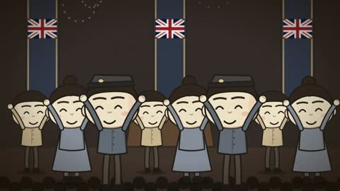

# `crowd` (action)

**Use it when:** Crowds: celebration ('the armistice was celebrated…'), protest or strikes ('workers went on strike…'), volunteers ('men rushed to enlist…').

**Do NOT use it when:** A leader's speech (speech).

**Camera (what the compiler does, per variant):** A: wide street full of people with the action, then a close face.

## Fields

| field | required | value | default | meaning |
|---|---|---|---|---|
| `mood` | no | one of `celebrate`, `protest`, `enlist`, `mourn` | `"celebrate"` | what the crowd does |
| `side` | no | side name |  | whose country (flags) |

Plus the common fields (`at`, `recipe`, `says`, `variant`, `date`, `place`, `name_card`, `label`, `counter`, `stamp`, `time`, `weather`, `tint`, …) — see [CATALOG.md](CATALOG.md#fields-every-card-can-have).

Variants: A (leave `variant` out: the compiler rotates them so the film never repeats a composition).

## Example card

```json
{
 "at": "In London, crowds filled",
 "recipe": "crowd",
 "says": "Londoners poured into the streets to celebrate the armistice.",
 "mood": "celebrate",
 "side": "british"
}
```

## Previews (middle frame of the example, each variant)

Variant A: 
