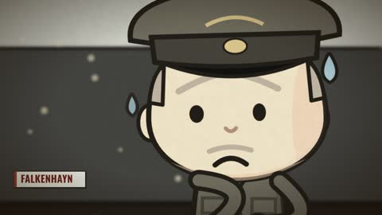
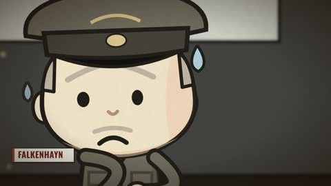
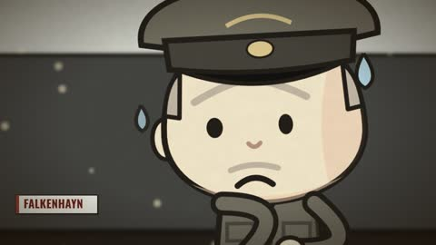

# `decision` (talk)

**Use it when:** A leader learns something or decides something: 'X decided…', 'X ordered…', 'X realised…', 'X had a problem…'. Keep it 3-6 s, then follow with a card that SHOWS the consequence (command → field).

**Do NOT use it when:** The narration describes what soldiers did (use an action recipe), or two people argue (use dialogue).

**Camera (what the compiler does, per variant):** A: medium at his desk → close-up just before the reaction → medium. B: the aide's shoulder in the foreground (over-the-shoulder), then close on the leader. C: he walks into the room reading, stops, reacts (tracking), close.

## Fields

| field | required | value | default | meaning |
|---|---|---|---|---|
| `who` | **yes** | cast id |  | cast id of the decision-maker |
| `setting` | no | one of `office`, `warroom`, `tent`, `bunker`, `cabinet`, `study`, `conference`, `radio`, `codebreak`, `hotel`, `train_interior`, `bridge` | `"office"` | where he is |
| `reads` | no | one of `telegram`, `paper`, `folder`, `photo`, `book`, `none` | `"telegram"` | what he holds at the start |
| `react` | no | one of `worried`, `angry`, `shocked`, `determined`, `sad`, `smug`, `panic`, `happy`, `nervous`, `tired` | `"determined"` | his reaction on react_on |
| `react_on` | no | words copied from this card's narration |  | word(s) where he reacts (default: middle of the scene) |
| `then` | no | one of `slam`, `point`, `pointL`, `write`, `phone`, `chin`, `cross`, `fist`, `explain` |  | what he does after reacting |
| `flag` | no | side name |  | side whose flag hangs on the wall (office/study/bunker) |
| `aide` | no | cast id |  | optional second person (an aide or officer) in the room |

Plus the common fields (`at`, `recipe`, `says`, `variant`, `date`, `place`, `name_card`, `label`, `counter`, `stamp`, `time`, `weather`, `tint`, …) — see [CATALOG.md](CATALOG.md#fields-every-card-can-have).

Variants: A, B, C (leave `variant` out: the compiler rotates them so the film never repeats a composition).

## Example card

```json
{
 "at": "By the end of 1915, the man",
 "recipe": "decision",
 "says": "Falkenhayn, Germany's top general, faced a war that could not be won by attacking.",
 "who": "falkenhayn",
 "setting": "warroom",
 "react": "worried",
 "react_on": "had a problem",
 "then": "chin",
 "name_card": "falkenhayn"
}
```

## Previews (middle frame of the example, each variant)

Variant A: 
Variant B: 
Variant C: 
