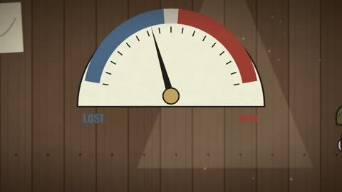

# `device` (device)

**Use it when:** The film's recurring scored device is updated (hourglass, scale, scoreboard, meter, ranking, timeline, ledger) — usually at a chapter end.

**Do NOT use it when:** —

**Camera (what the compiler does, per variant):** A: device wide with the host → close on the device as it changes → (stamp).

## Fields

| field | required | value | default | meaning |
|---|---|---|---|---|
| `element` | **yes** | object |  | the device element exactly as in references/plan-schema.md §Storytelling devices (kind + fields) |
| `host` | no | true / false | `true` | the host stands beside it |
| `stamp` | no | object |  | {"text": "NOT YET", "on": "phrase"} stamped beside it |

Plus the common fields (`at`, `recipe`, `says`, `variant`, `date`, `place`, `name_card`, `label`, `counter`, `stamp`, `time`, `weather`, `tint`, …) — see [CATALOG.md](CATALOG.md#fields-every-card-can-have).

Variants: A (leave `variant` out: the compiler rotates them so the film never repeats a composition).

## Example card

```json
{
 "at": "So, did the sand run out",
 "recipe": "device",
 "says": "The device shows the war is not yet lost for Germany.",
 "element": {
  "kind": "meter",
  "value": -0.2,
  "left": "LOST",
  "right": "WON",
  "title": "GERMANY'S CHANCES"
 }
}
```

## Previews (middle frame of the example, each variant)

Variant A: 
