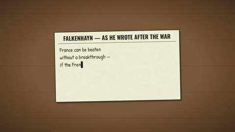
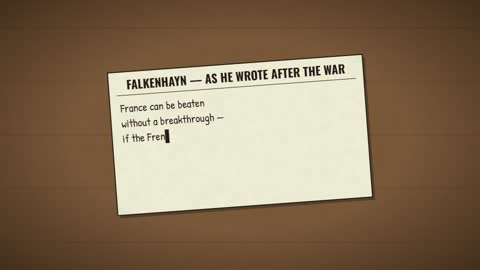

# `document` (device)

**Use it when:** The words of a paper matter: an order, a telegram, a treaty clause, a memo, a diary line. ≤ 4 s, then cut to what it causes.

**Do NOT use it when:** Who reads it matters more (report / decision).

**Camera (what the compiler does, per variant):** A: top-down on a wooden desk, typed line by line, slow push. B: same paper held up in a hand, slight tilt.

## Fields

| field | required | value | default | meaning |
|---|---|---|---|---|
| `style` | no | one of `telegram`, `letter`, `order`, `newspaper`, `note`, `book` | `"telegram"` | kind of paper |
| `title` | **yes** | text |  | heading of the paper (CAPITALS for telegrams/orders) |
| `lines` | **yes** | list |  | 1-3 short lines of text (the narration's key words) |
| `stamp` | no | text |  | stamp after the text is typed: SECRET, APPROVED, REJECTED, URGENT |

Plus the common fields (`at`, `recipe`, `says`, `variant`, `date`, `place`, `name_card`, `label`, `counter`, `stamp`, `time`, `weather`, `tint`, …) — see [CATALOG.md](CATALOG.md#fields-every-card-can-have).

Variants: A, B (leave `variant` out: the compiler rotates them so the film never repeats a composition).

## Example card

```json
{
 "at": "According to the memoirs",
 "recipe": "document",
 "says": "After the war Falkenhayn wrote that he meant to bleed France, not break through.",
 "style": "letter",
 "title": "FALKENHAYN — AS HE WROTE AFTER THE WAR",
 "lines": [
  "France can be beaten",
  "without a breakthrough —",
  "if the French army loses enough men."
 ]
}
```

## Previews (middle frame of the example, each variant)

Variant A: 
Variant B: 
