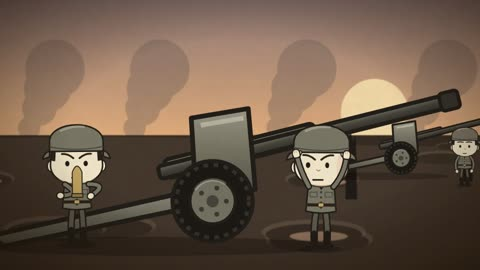
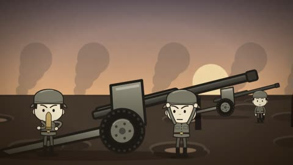

# `gun_crew` (action)

**Use it when:** Artillery fires: 'the guns opened fire…', 'a bombardment…', 'let the heavy guns do the killing…', 'the barrage began…'.

**Do NOT use it when:** Shells landing on men (under_fire / assault with shells).

**Camera (what the compiler does, per variant):** A: wide of the battery → medium-close on the layer covering his ears as the gun fires → wide again on the smoke. B: start on the loader carrying the shell (medium), then the battery wide.

## Fields

| field | required | value | default | meaning |
|---|---|---|---|---|
| `side` | no | side name |  | whose guns |
| `heavy` | no | true / false | `true` | heavy howitzers (bigger guns) |
| `fire_on` | no | words copied from this card's narration |  | word(s) for the main shot (the second gun fires on other beats) |
| `time` | no | one of `day`, `dusk`, `dawn`, `night` | `"dusk"` | dusk/night make the flashes read best |

Plus the common fields (`at`, `recipe`, `says`, `variant`, `date`, `place`, `name_card`, `label`, `counter`, `stamp`, `time`, `weather`, `tint`, …) — see [CATALOG.md](CATALOG.md#fields-every-card-can-have).

Variants: A, B (leave `variant` out: the compiler rotates them so the film never repeats a composition).

## Example card

```json
{
 "at": "and let German heavy guns",
 "recipe": "gun_crew",
 "says": "Falkenhayn wanted artillery, not infantry, to do the killing.",
 "side": "german",
 "fire_on": "heavy guns",
 "time": "dusk"
}
```

## Previews (middle frame of the example, each variant)

Variant A: 
Variant B: 
