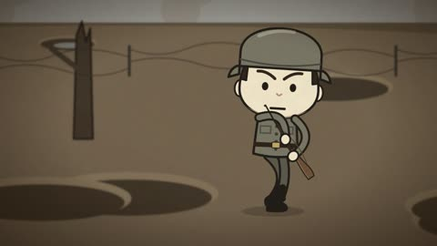

# `hit` (action)

**Use it when:** One man's death or wound stands for many: 'the army that was supposed to bleed was the German army too', 'he was killed…'.

**Do NOT use it when:** Many fall at once (assault with falls).

**Camera (what the compiler does, per variant):** A: full shot tracking him advancing → he falls → his comrade runs in and kneels → close-up of the comrade crying.

## Fields

| field | required | value | default | meaning |
|---|---|---|---|---|
| `side` | no | side name |  | the man who is hit |
| `hit_on` | no | words copied from this card's narration |  | word(s) where he is hit |
| `burst` | no | true / false | `true` | a shell bursts behind him at that moment |

Plus the common fields (`at`, `recipe`, `says`, `variant`, `date`, `place`, `name_card`, `label`, `counter`, `stamp`, `time`, `weather`, `tint`, …) — see [CATALOG.md](CATALOG.md#fields-every-card-can-have).

Variants: A (leave `variant` out: the compiler rotates them so the film never repeats a composition).

## Example card

```json
{
 "at": "The army that was supposed to bleed",
 "recipe": "hit",
 "says": "German soldiers died at Verdun as fast as the French.",
 "side": "german",
 "hit_on": "German army"
}
```

## Previews (middle frame of the example, each variant)

Variant A: 
