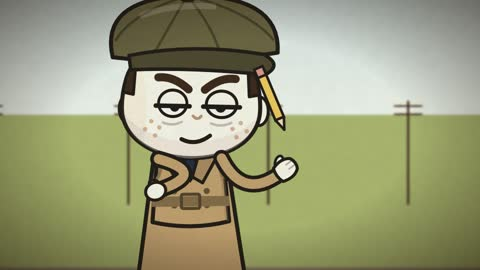
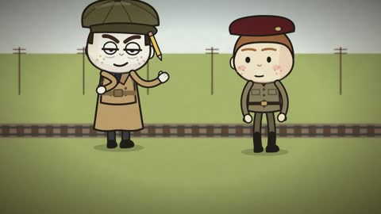

# `host` (host)

**Use it when:** The channel's narrator speaks to the viewer: the opening hook, chapter transitions, the verdict, rhetorical questions ('So, was this the turning point?').

**Do NOT use it when:** Inside a battle or a historical scene.

**Camera (what the compiler does, per variant):** A: medium, he gestures; close-up on the key line. B: full shot with the aide, then a close-up.

## Fields

| field | required | value | default | meaning |
|---|---|---|---|---|
| `aide` | no | true / false | `false` | the aide stands beside him and reacts |
| `mood` | no | one of `smug`, `neutral`, `determined`, `sad`, `worried`, `happy` | `"smug"` | expression |
| `close_on` | no | words copied from this card's narration |  | word(s) where the camera cuts to a close-up (the key line) |
| `holds` | no | one of `none`, `stopwatch`, `telegram`, `paper`, `book`, `photo`, `medal` | `"none"` | prop in his hand |
| `setting` | no | text |  | host set (default from cards/_film.json "host_set", else study) |
| `label` | no | text |  | 1-5 word tag at the top |

Plus the common fields (`at`, `recipe`, `says`, `variant`, `date`, `place`, `name_card`, `label`, `counter`, `stamp`, `time`, `weather`, `tint`, …) — see [CATALOG.md](CATALOG.md#fields-every-card-can-have).

Variants: A, B (leave `variant` out: the compiler rotates them so the film never repeats a composition).

## Example card

```json
{
 "at": "So, did the sand run out here?",
 "recipe": "host",
 "says": "The narrator asks whether this was the decisive moment.",
 "mood": "smug",
 "close_on": "Not yet"
}
```

## Previews (middle frame of the example, each variant)

Variant A: 
Variant B: 
