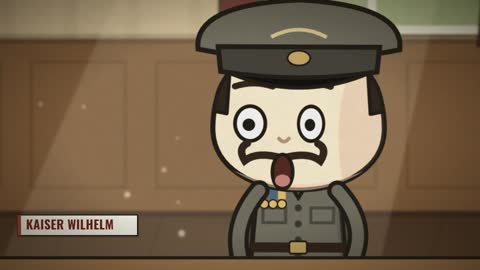
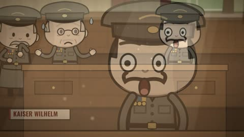

# `interrupt` (talk)

**Use it when:** Someone is told / receives the news while doing his work: 'they told the Kaiser…', 'the report reached Churchill at his desk…'. The listener's BUSINESS (writing, reading, phoning) stops on the words that hit him.

**Do NOT use it when:** Nobody is working when the news comes (dialogue), or the message is a telegram handed over (report).

**Camera (what the compiler does, per variant):** A: full shot of the room (speakers left, worker at the desk right) → dissolve to a medium-close of the worker on react_on. B: medium on the worker at his business first, the speakers enter frame, then the close-up.

## Fields

| field | required | value | default | meaning |
|---|---|---|---|---|
| `who` | **yes** | cast id |  | the person at work (the listener) |
| `speakers` | **yes** | list |  | 1-2 cast ids who bring the news (they stand on the left) |
| `business` | no | one of `write`, `read`, `phone`, `map`, `typing` | `"write"` | what he is doing when they come in |
| `look_up_on` | no | words copied from this card's narration |  | word(s) where he stops and looks up (default: his name / early) |
| `react_on` | no | words copied from this card's narration |  | word(s) where the news hits him (close-up) |
| `react` | no | one of `neutral`, `worried`, `determined`, `sad`, `shocked`, `angry`, `tired`, `smug`, `happy`, `panic` | `"shocked"` | his reaction |
| `setting` | no | one of `office`, `study`, `warroom`, `cabinet`, `conference`, `bunker`, `tent`, `radio`, `codebreak`, `hotel`, `home`, `kitchen`, `train_interior`, `bridge` | `"office"` | the room |
| `flag` | no | side name |  | flag and portrait on the wall |

Plus the common fields (`at`, `recipe`, `says`, `variant`, `date`, `place`, `name_card`, `label`, `counter`, `stamp`, `time`, `weather`, `tint`, …) — see [CATALOG.md](CATALOG.md#fields-every-card-can-have).

Variants: A, B (leave `variant` out: the compiler rotates them so the film never repeats a composition).

## Example card

```json
{
 "at": "told Kaiser Wilhelm",
 "recipe": "interrupt",
 "says": "The generals tell the Kaiser the front cannot hold; he stops writing, stunned.",
 "who": "kaiser_wilhelm",
 "speakers": [
  "ludendorff",
  "hindenburg"
 ],
 "business": "write",
 "look_up_on": "Kaiser Wilhelm",
 "react_on": "could no longer",
 "react": "shocked",
 "setting": "office",
 "flag": "german",
 "name_card": "kaiser_wilhelm"
}
```

## Previews (middle frame of the example, each variant)

Variant A: 
Variant B: 
