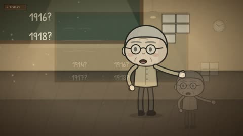
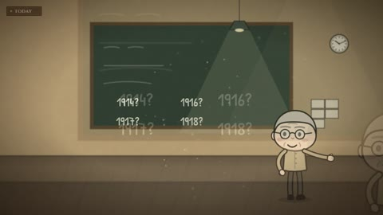

# `lecture` (talk)

**Use it when:** The debate itself: 'historians disagree', 'ask around and you'll get a list', 'there are three explanations'. A historian chalks the options on a blackboard as they are named.

**Do NOT use it when:** The options are events you can show (show the events instead, one card each).

**Camera (what the compiler does, per variant):** A: full shot — he writes with his back to us, then turns and points at the board. B: medium on the board first, then him turning.

## Fields

| field | required | value | default | meaning |
|---|---|---|---|---|
| `items` | **yes** | list |  | 2-6 very short items written on the board, e.g. ["1914?", "1916?", "1917?"] |
| `items_on` | no | list |  | optional: for each item the word(s) where it is written |
| `who` | no | cast id | `"civilian_man"` | the historian (default: an old scholar with glasses) |

Plus the common fields (`at`, `recipe`, `says`, `variant`, `date`, `place`, `name_card`, `label`, `counter`, `stamp`, `time`, `weather`, `tint`, …) — see [CATALOG.md](CATALOG.md#fields-every-card-can-have).

Variants: A, B (leave `variant` out: the compiler rotates them so the film never repeats a composition).

## Example card

```json
{
 "at": "Ask around and",
 "recipe": "lecture",
 "says": "Historians propose several different turning points.",
 "items": [
  "1914?",
  "1916?",
  "1917?",
  "1918?"
 ],
 "tag": "Today"
}
```

## Previews (middle frame of the example, each variant)

Variant A: 
Variant B: 
