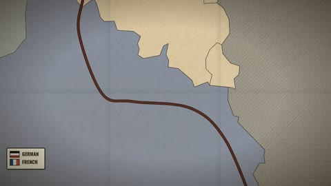

# `map_front` (map)

**Use it when:** A front line forms or moves: 'the front settled…', 'the line ran from the sea to Switzerland', 'they were pushed back to…'.

**Do NOT use it when:** A single attack (map_move).

**Camera (what the compiler does, per variant):** A: the line draws itself, then (with to_line) slides to its new position.

## Fields

| field | required | value | default | meaning |
|---|---|---|---|---|
| `side` | no | side name |  | the side holding the line (colour of the line) |
| `line` | **yes** | list |  | place names along the front, north to south (3-10 names) |
| `to_line` | no | list |  | place names of the later line — the front slides from line to to_line |
| `move_on` | no | words copied from this card's narration |  | word(s) where the line starts moving |
| `show` | no | list |  | extra place names to mark |
| `enemy` | no | side name |  | the other side (its countries are coloured too) |

Plus the common fields (`at`, `recipe`, `says`, `variant`, `date`, `place`, `name_card`, `label`, `counter`, `stamp`, `time`, `weather`, `tint`, …) — see [CATALOG.md](CATALOG.md#fields-every-card-can-have).

Variants: A (leave `variant` out: the compiler rotates them so the film never repeats a composition).

## Example card

```json
{
 "at": "By Christmas the front ran",
 "recipe": "map_front",
 "says": "A continuous trench line now ran from the Channel to Switzerland.",
 "side": "german",
 "enemy": "french",
 "line": [
  "Nieuport",
  "Ypres",
  "Arras",
  "Soissons",
  "Reims",
  "Verdun",
  "Nancy",
  "Belfort"
 ]
}
```

## Previews (middle frame of the example, each variant)

Variant A: 
