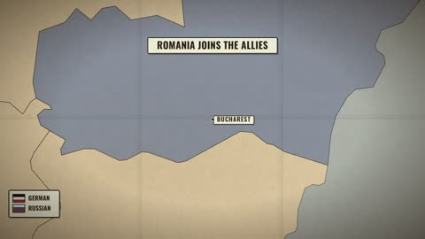
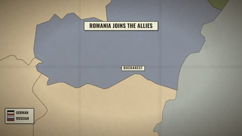

# `map_locate` (map)

**Use it when:** Where a place is or which countries are involved: 'a fortress town on the Meuse…', 'Romania joined the Allies…', 'in Silesia…'.

**Do NOT use it when:** Something moves (map_move / map_route).

**Camera (what the compiler does, per variant):** A: framed on the places, they appear one by one. B: starts on the continent and zooms in to the key place.

## Fields

| field | required | value | default | meaning |
|---|---|---|---|---|
| `places` | **yes** | list |  | place names to mark (the first is the key place, on a tag) |
| `side` | no | side name |  | main side (coloured) |
| `others` | no | list |  | other sides to colour, e.g. ["french", "british"] |
| `highlight` | no | list |  | countries to tint with highlight_side's colour |
| `highlight_side` | no | side name |  | colour for the highlighted countries |
| `zoom` | no | one of `city`, `region`, `country`, `continent` | `"region"` | how far out |

Plus the common fields (`at`, `recipe`, `says`, `variant`, `date`, `place`, `name_card`, `label`, `counter`, `stamp`, `time`, `weather`, `tint`, …) — see [CATALOG.md](CATALOG.md#fields-every-card-can-have).

Variants: A, B (leave `variant` out: the compiler rotates them so the film never repeats a composition).

## Example card

```json
{
 "at": "and Romania was encouraged",
 "recipe": "map_locate",
 "says": "Romania entered the war on the Allied side.",
 "places": [
  "Bucharest"
 ],
 "side": "german",
 "others": [
  "russian"
 ],
 "highlight": [
  "Romania"
 ],
 "highlight_side": "french",
 "zoom": "country",
 "label": "ROMANIA JOINS THE ALLIES"
}
```

## Previews (middle frame of the example, each variant)

Variant A: 
Variant B: 
