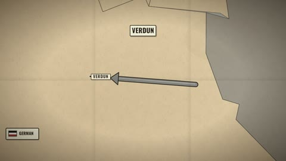
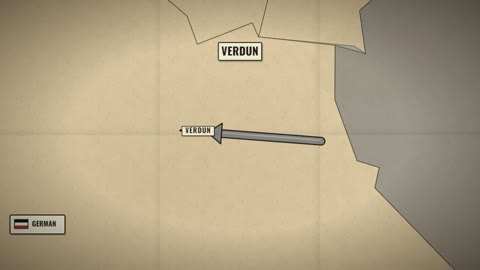

# `map_move` (map)

**Use it when:** Where something moved: 'they advanced to…', 'the Germans pushed toward…', 'divisions were sent east', 'an attack at X'.

**Do NOT use it when:** The movement itself is the story (show the men: march / convoy / wave). Keep maps short.

**Camera (what the compiler does, per variant):** A: map framed on the move, arrow draws on the word, gentle push. B: starts wider, pushes in toward the arrow head.

## Fields

| field | required | value | default | meaning |
|---|---|---|---|---|
| `side` | no | side name |  | whose movement (colour) |
| `from` | **yes** | text |  | place name where it starts |
| `to` | **yes** | text |  | place name where it ends |
| `via` | no | list |  | optional place names in between |
| `label` | no | text |  | 1-3 word tag on the arrow |
| `dashed` | no | true / false | `false` | a plan or intention (not a real move) |
| `on` | no | words copied from this card's narration |  | word(s) where the arrow starts drawing |
| `others` | no | list |  | more arrows: [{"side": ..., "from": ..., "to": ..., "on": ...}] (max 2) |
| `show` | no | list |  | extra place names to mark |
| `highlight` | no | list |  | countries to tint, e.g. ["Romania"] (as named on the era's map) |
| `highlight_side` | no | side name |  | side whose colour the highlighted countries get |

Plus the common fields (`at`, `recipe`, `says`, `variant`, `date`, `place`, `name_card`, `label`, `counter`, `stamp`, `time`, `weather`, `tint`, …) — see [CATALOG.md](CATALOG.md#fields-every-card-can-have).

Variants: A, B (leave `variant` out: the compiler rotates them so the film never repeats a composition).

## Example card

```json
{
 "at": "The place he picked was Verdun",
 "recipe": "map_move",
 "says": "Falkenhayn chose Verdun, a fortress the French would never give up.",
 "side": "german",
 "from": "Metz",
 "to": "Verdun",
 "label": "VERDUN",
 "show": [
  "Verdun"
 ]
}
```

## Previews (middle frame of the example, each variant)

Variant A: 
Variant B: 
