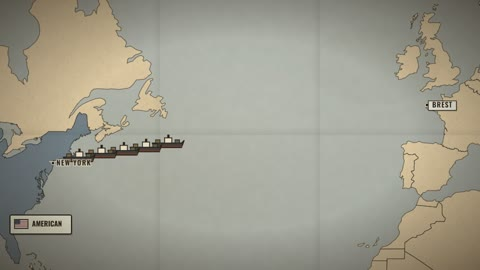

# `map_route` (map)

**Use it when:** Ships, convoys, trains or armies travelling a long way: 'convoys crossed the Atlantic…', 'troops shipped to France…'.

**Do NOT use it when:** Short moves (map_move).

**Camera (what the compiler does, per variant):** A: the dashed route draws with icons riding it; the camera follows the lead icon.

## Fields

| field | required | value | default | meaning |
|---|---|---|---|---|
| `side` | no | side name |  | whose movers |
| `route` | **yes** | list |  | place names along the route, in order |
| `icon` | no | one of `freighter`, `warship`, `truck`, `tank`, `train`, `column`, `crate` | `"freighter"` | what travels |
| `count` | no | whole number | `4` | how many icons follow each other |

Plus the common fields (`at`, `recipe`, `says`, `variant`, `date`, `place`, `name_card`, `label`, `counter`, `stamp`, `time`, `weather`, `tint`, …) — see [CATALOG.md](CATALOG.md#fields-every-card-can-have).

Variants: A (leave `variant` out: the compiler rotates them so the film never repeats a composition).

## Example card

```json
{
 "at": "American troops crossed the Atlantic",
 "recipe": "map_route",
 "says": "Two million Americans were shipped to France.",
 "side": "american",
 "route": [
  "New York",
  "Brest"
 ],
 "icon": "freighter",
 "count": 5
}
```

## Previews (middle frame of the example, each variant)

Variant A: 
