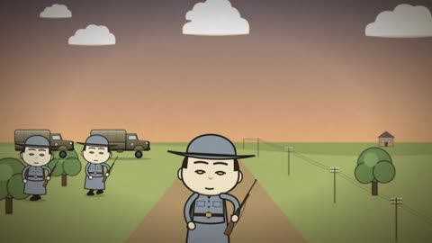
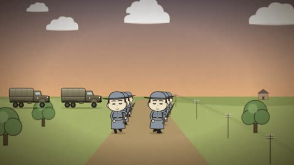
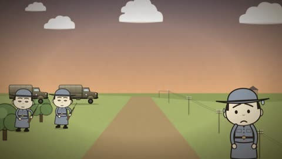

# `march` (action)

**Use it when:** Troops move on foot to somewhere: 'the army marched…', 'reinforcements were sent…', 'they moved up to the front…'.

**Do NOT use it when:** They attack (assault/wave) or travel by vehicle (convoy) or by rail (rail).

**Camera (what the compiler does, per variant):** A: side view in two files at different depths → close on one marching face. B: column comes down the road toward the camera (depth). C: three planes: vehicles far, a file mid, one soldier near watching them pass.

## Fields

| field | required | value | default | meaning |
|---|---|---|---|---|
| `side` | no | side name |  | whose troops (default: the film's first side) |
| `mood` | no | one of `determined`, `tired`, `worried`, `shout`, `panic`, `sad`, `happy`, `nervous` | `"determined"` | faces |
| `setting` | no | one of `countryside`, `field`, `steppe`, `snow`, `desert`, `mud`, `polder`, `street`, `nomansland`, `jungle` | `"countryside"` | landscape |
| `direction` | no | one of `right`, `left` | `"right"` | which way they march (keep one side's direction consistent in a chapter) |
| `vehicles` | no | true / false | `false` | add trucks/tanks on the far road |

Plus the common fields (`at`, `recipe`, `says`, `variant`, `date`, `place`, `name_card`, `label`, `counter`, `stamp`, `time`, `weather`, `tint`, …) — see [CATALOG.md](CATALOG.md#fields-every-card-can-have).

Variants: A, B, C (leave `variant` out: the compiler rotates them so the film never repeats a composition).

## Example card

```json
{
 "at": "Reinforcements streamed toward the town",
 "recipe": "march",
 "says": "French reinforcements kept pouring toward Verdun.",
 "side": "french",
 "mood": "tired",
 "vehicles": true,
 "time": "dusk"
}
```

## Previews (middle frame of the example, each variant)

Variant A: 
Variant B: 
Variant C: 
