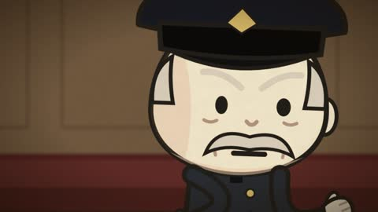
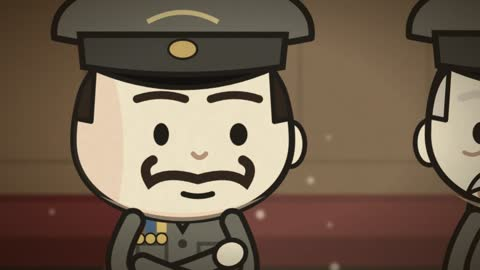

# `meeting` (talk)

**Use it when:** A council, conference or staff meeting decides something: 'the generals met…', 'at the conference…', 'the cabinet agreed…'.

**Do NOT use it when:** Only one or two people matter (decision / dialogue).

**Camera (what the compiler does, per variant):** A: the table wide → speaker medium → the others reacting (group medium) → speaker close on the slam. B: speaker close first, then the room, then a listener's close-up.

## Fields

| field | required | value | default | meaning |
|---|---|---|---|---|
| `people` | **yes** | list |  | 2-5 cast ids around the table, left to right |
| `speaker` | no | whole number | `0` | index (0 = first) of the one who talks |
| `slam_on` | no | words copied from this card's narration |  | word(s) where the speaker slams the table / points (the decision lands) |
| `mood` | no | one of `worried`, `angry`, `shocked`, `determined`, `sad`, `smug`, `panic`, `happy`, `nervous`, `tired` | `"worried"` | the others' expression |
| `setting` | no | one of `conference`, `cabinet`, `warroom`, `tent`, `bunker`, `parliament` | `"conference"` | where |

Plus the common fields (`at`, `recipe`, `says`, `variant`, `date`, `place`, `name_card`, `label`, `counter`, `stamp`, `time`, `weather`, `tint`, …) — see [CATALOG.md](CATALOG.md#fields-every-card-can-have).

Variants: A, B (leave `variant` out: the compiler rotates them so the film never repeats a composition).

## Example card

```json
{
 "at": "On the 9th of January",
 "recipe": "meeting",
 "says": "The Kaiser's council approved unrestricted submarine war.",
 "people": [
  "holtzendorff",
  "kaiser_wilhelm",
  "hindenburg"
 ],
 "speaker": 0,
 "slam_on": "approved"
}
```

## Previews (middle frame of the example, each variant)

Variant A: 
Variant B: 
