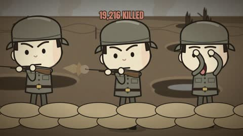
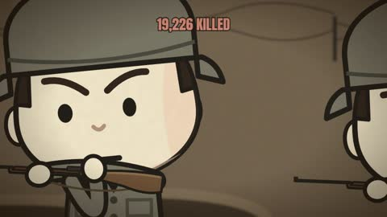

# `mg_nest` (action)

**Use it when:** Defenders mow down an attack: 'machine guns cut them down…', '19,240 killed…', 'the defenders opened fire…'.

**Do NOT use it when:** —

**Camera (what the compiler does, per variant):** A: medium over the sandbags → medium-close on the gunner (flashes, small shake). B: close on the gunner first, then the group.

## Fields

| field | required | value | default | meaning |
|---|---|---|---|---|
| `side` | no | side name |  | who mans the guns (the defenders) |
| `direction` | no | one of `left`, `right` | `"left"` | which way they fire (toward the attackers' side of the screen) |
| `spotter` | no | true / false | `true` | a man with binoculars beside them |

Plus the common fields (`at`, `recipe`, `says`, `variant`, `date`, `place`, `name_card`, `label`, `counter`, `stamp`, `time`, `weather`, `tint`, …) — see [CATALOG.md](CATALOG.md#fields-every-card-can-have).

Variants: A, B (leave `variant` out: the compiler rotates them so the film never repeats a composition).

## Example card

```json
{
 "at": "including nineteen thousand",
 "recipe": "mg_nest",
 "says": "German machine guns killed nearly twenty thousand British soldiers that day.",
 "side": "german",
 "counter": {
  "to": 19240,
  "suffix": " KILLED",
  "on": "nineteen thousand",
  "color": "#f08070"
 }
}
```

## Previews (middle frame of the example, each variant)

Variant A: 
Variant B: 
