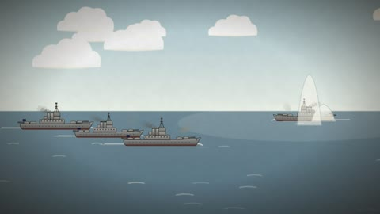

# `naval_battle` (action)

**Use it when:** Fleets fight: 'the fleets met…', 'the battlecruisers exchanged fire…', 'the guns of the fleet…'.

**Do NOT use it when:** One ship sinking (sinking); submarines (submarine_attack).

**Camera (what the compiler does, per variant):** A: line of ships firing (wide) → splashes around the enemy → closer on the hit ship. B: on the deck/bridge first (the gun fires), then the wide.

## Fields

| field | required | value | default | meaning |
|---|---|---|---|---|
| `side` | no | side name |  | first fleet |
| `enemy` | no | side name |  | second fleet |
| `hit_on` | no | words copied from this card's narration |  | word(s) where a ship is hit |
| `time` | no | one of `day`, `dusk`, `night` | `"day"` | time |

Plus the common fields (`at`, `recipe`, `says`, `variant`, `date`, `place`, `name_card`, `label`, `counter`, `stamp`, `time`, `weather`, `tint`, …) — see [CATALOG.md](CATALOG.md#fields-every-card-can-have).

Variants: A, B (leave `variant` out: the compiler rotates them so the film never repeats a composition).

## Example card

```json
{
 "at": "the two fleets met off Jutland",
 "recipe": "naval_battle",
 "says": "The British and German fleets fought the war's only great sea battle.",
 "side": "british",
 "enemy": "german"
}
```

## Previews (middle frame of the example, each variant)

Variant A: 
Variant B: 
