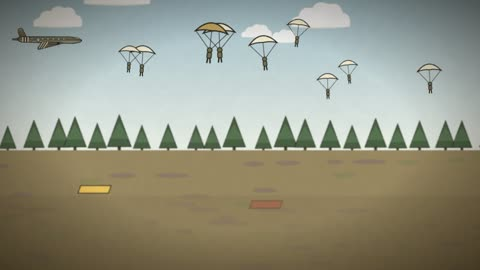
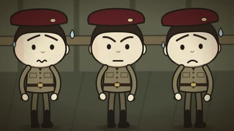

# `para_drop` (action)

**Use it when:** Airborne landings: 'paratroopers dropped…', 'gliders landed…'.

**Do NOT use it when:** —

**Camera (what the compiler does, per variant):** A: transports cross the sky and canopies bloom (wide). B: inside the cabin at the green light, then the sky.

## Fields

| field | required | value | default | meaning |
|---|---|---|---|---|
| `side` | no | side name |  | whose aircraft |

Plus the common fields (`at`, `recipe`, `says`, `variant`, `date`, `place`, `name_card`, `label`, `counter`, `stamp`, `time`, `weather`, `tint`, …) — see [CATALOG.md](CATALOG.md#fields-every-card-can-have).

Variants: A, B (leave `variant` out: the compiler rotates them so the film never repeats a composition).

## Example card

```json
{
 "at": "the first lift dropped",
 "recipe": "para_drop",
 "says": "British paratroopers landed far from the bridge.",
 "side": "british"
}
```

## Previews (middle frame of the example, each variant)

Variant A: 
Variant B: 
