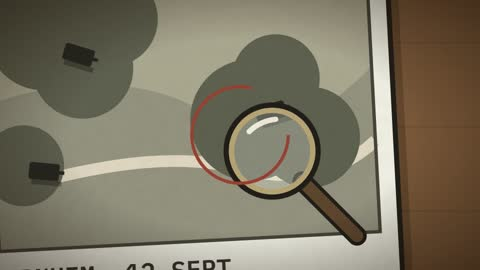

# `photo_evidence` (device)

**Use it when:** Evidence on a desk: a reconnaissance photo, a map with circles, a captured paper being examined.

**Do NOT use it when:** —

**Camera (what the compiler does, per variant):** A: top-down desk, the photo under a magnifier, a red ring drawn on the word.

## Fields

| field | required | value | default | meaning |
|---|---|---|---|---|
| `caption` | no | text | `""` | caption on the photo |
| `ring_on` | no | words copied from this card's narration |  | word(s) where a red ring circles the key spot |

Plus the common fields (`at`, `recipe`, `says`, `variant`, `date`, `place`, `name_card`, `label`, `counter`, `stamp`, `time`, `weather`, `tint`, …) — see [CATALOG.md](CATALOG.md#fields-every-card-can-have).

Variants: A (leave `variant` out: the compiler rotates them so the film never repeats a composition).

## Example card

```json
{
 "at": "The photographs showed tanks",
 "recipe": "photo_evidence",
 "says": "Air photos proved there were German tanks near Arnhem.",
 "caption": "ARNHEM, 12 SEPT",
 "ring_on": "tanks"
}
```

## Previews (middle frame of the example, each variant)

Variant A: 
