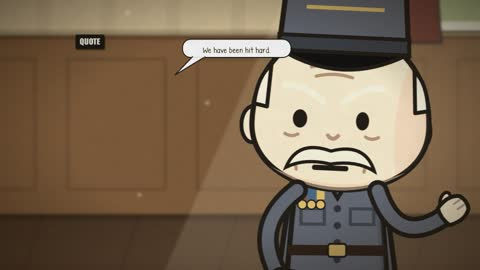
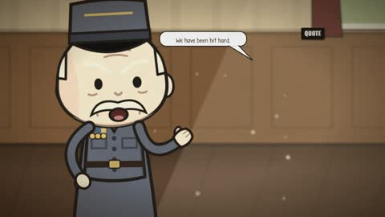

# `quote` (talk)

**Use it when:** The narration quotes someone's words: 'he said…', 'he wrote…', 'in his words…'. The line appears in a speech bubble.

**Do NOT use it when:** Long speeches (use speech with a crowd); quotes longer than ~15 words (shorten the bubble text).

**Camera (what the compiler does, per variant):** A: medium-close on the speaker, bubble on the left. B: a slow push from medium to close, bubble on the right.

## Fields

| field | required | value | default | meaning |
|---|---|---|---|---|
| `who` | **yes** | cast id |  | who said it |
| `text` | **yes** | text |  | the quoted words for the bubble (≤ 15 words, exactly as narrated or shortened) |
| `tag` | no | text |  | small tag under the bubble, e.g. 'QUOTE' or 'REPORTED · UNPROVEN' |
| `mood` | no | one of `worried`, `angry`, `shocked`, `determined`, `sad`, `smug`, `panic`, `happy`, `nervous`, `tired` | `"determined"` | expression |
| `setting` | no | one of `office`, `warroom`, `tent`, `bunker`, `cabinet`, `study`, `conference`, `radio`, `codebreak`, `hotel`, `train_interior`, `bridge`, `podium`, `street`, `trench`, `deck` | `"office"` | where |

Plus the common fields (`at`, `recipe`, `says`, `variant`, `date`, `place`, `name_card`, `label`, `counter`, `stamp`, `time`, `weather`, `tint`, …) — see [CATALOG.md](CATALOG.md#fields-every-card-can-have).

Variants: A, B (leave `variant` out: the compiler rotates them so the film never repeats a composition).

## Example card

```json
{
 "at": "I have been hit",
 "recipe": "quote",
 "says": "The general admitted the attack had failed, in his own words.",
 "who": "foch",
 "text": "We have been hit hard.",
 "tag": "QUOTE"
}
```

## Previews (middle frame of the example, each variant)

Variant A: 
Variant B: 
