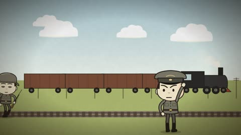
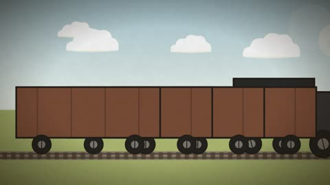

# `rail` (action)

**Use it when:** Troops or supplies go by train: 'divisions were sent east…', 'by rail…', 'trains carried…'.

**Do NOT use it when:** —

**Camera (what the compiler does, per variant):** A: soldiers walk toward the train as it pulls out, an officer waves them on. B: the train passes close, faces at the windows (wide, shake).

## Fields

| field | required | value | default | meaning |
|---|---|---|---|---|
| `side` | no | side name |  | whose train |

Plus the common fields (`at`, `recipe`, `says`, `variant`, `date`, `place`, `name_card`, `label`, `counter`, `stamp`, `time`, `weather`, `tint`, …) — see [CATALOG.md](CATALOG.md#fields-every-card-can-have).

Variants: A, B (leave `variant` out: the compiler rotates them so the film never repeats a composition).

## Example card

```json
{
 "at": "Germany had to send divisions east",
 "recipe": "rail",
 "says": "Germany had to move whole divisions east by train to rescue Austria.",
 "side": "german"
}
```

## Previews (middle frame of the example, each variant)

Variant A: 
Variant B: 
