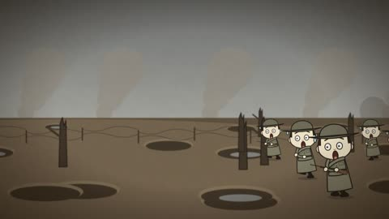
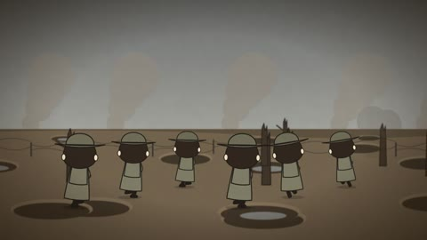

# `retreat` (action)

**Use it when:** An army falls back: 'they retreated…', 'the front collapsed…', 'they fled…', 'the defenders ran'.

**Do NOT use it when:** Orderly withdrawal by road with vehicles (convoy, direction away).

**Camera (what the compiler does, per variant):** A: wide, men running past, looking back → close on a frightened face. B: back view running away into depth.

## Fields

| field | required | value | default | meaning |
|---|---|---|---|---|
| `side` | no | side name |  | who retreats |
| `direction` | no | one of `left`, `right` | `"left"` | which way they run |
| `shells` | no | whole number | `2` | bursts behind them |

Plus the common fields (`at`, `recipe`, `says`, `variant`, `date`, `place`, `name_card`, `label`, `counter`, `stamp`, `time`, `weather`, `tint`, …) — see [CATALOG.md](CATALOG.md#fields-every-card-can-have).

Variants: A, B (leave `variant` out: the compiler rotates them so the film never repeats a composition).

## Example card

```json
{
 "at": "The front gave way",
 "recipe": "retreat",
 "says": "The defending line broke and the men ran.",
 "side": "italian"
}
```

## Previews (middle frame of the example, each variant)

Variant A: 
Variant B: 
