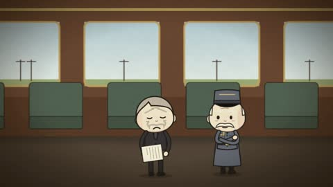
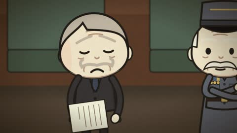

# `signing` (talk)

**Use it when:** A treaty, armistice, order or surrender is signed: 'they signed…', 'the armistice was signed…', 'he signed the order…'.

**Do NOT use it when:** The text of the document matters more (document).

**Camera (what the compiler does, per variant):** A: wide of the table → the pen in close-up (insert) → the witnesses' faces. B: over the witness's shoulder → signer close → paper.

## Fields

| field | required | value | default | meaning |
|---|---|---|---|---|
| `who` | **yes** | cast id |  | who signs |
| `witnesses` | no | list |  | 0-3 cast ids standing behind |
| `sign_on` | no | words copied from this card's narration |  | word(s) where the pen touches the paper |
| `setting` | no | one of `conference`, `train_interior`, `cabinet`, `tent`, `office` | `"conference"` | where (armistice in a railway carriage: train_interior) |
| `mood` | no | one of `worried`, `angry`, `shocked`, `determined`, `sad`, `smug`, `panic`, `happy`, `nervous`, `tired` | `"sad"` | signer's expression |

Plus the common fields (`at`, `recipe`, `says`, `variant`, `date`, `place`, `name_card`, `label`, `counter`, `stamp`, `time`, `weather`, `tint`, …) — see [CATALOG.md](CATALOG.md#fields-every-card-can-have).

Variants: A, B (leave `variant` out: the compiler rotates them so the film never repeats a composition).

## Example card

```json
{
 "at": "At 5 a.m. on the 11th of November",
 "recipe": "signing",
 "says": "Germany's delegates signed the armistice in Foch's railway carriage.",
 "who": "zimmermann",
 "witnesses": [
  "foch"
 ],
 "setting": "train_interior",
 "mood": "sad"
}
```

## Previews (middle frame of the example, each variant)

Variant A: 
Variant B: 
