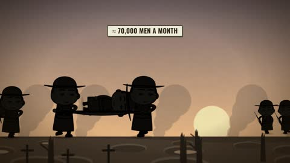

# `silhouette` (action)

**Use it when:** A grief or endurance beat over a big number or a long time: '70,000 men a month…', 'for most of a year…', 'a whole generation'.

**Do NOT use it when:** —

**Camera (what the compiler does, per variant):** A: one dusk wide: black figures on the ridge against the sun, crosses appearing one by one in the foreground.

## Fields

| field | required | value | default | meaning |
|---|---|---|---|---|
| `side` | no | side name |  | whose men |
| `what` | no | one of `stretcher`, `column`, `crosses` | `"stretcher"` | what crosses the ridge |

Plus the common fields (`at`, `recipe`, `says`, `variant`, `date`, `place`, `name_card`, `label`, `counter`, `stamp`, `time`, `weather`, `tint`, …) — see [CATALOG.md](CATALOG.md#fields-every-card-can-have).

Variants: A (leave `variant` out: the compiler rotates them so the film never repeats a composition).

## Example card

```json
{
 "at": "That's roughly seventy thousand men",
 "recipe": "silhouette",
 "says": "Verdun consumed about seventy thousand men every month.",
 "side": "french",
 "label": {
  "text": "≈ 70,000 MEN A MONTH",
  "on": "seventy thousand"
 }
}
```

## Previews (middle frame of the example, each variant)

Variant A: 
