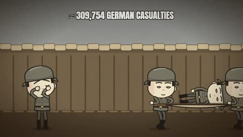

# `stretcher` (action)

**Use it when:** The wounded, the cost carried back: 'casualties mounted…', '337,000 German casualties…', 'the wounded…'. A number can run on top (counter).

**Do NOT use it when:** Grief / the dead at dusk (silhouette).

**Camera (what the compiler does, per variant):** A: bearers walk through the trench past a man sitting with his head in his hands (one set-up with a pan). B: in the open: two teams in depth, then a medium on the near team.

## Fields

| field | required | value | default | meaning |
|---|---|---|---|---|
| `side` | no | side name |  | whose wounded |
| `setting` | no | one of `trench`, `nomansland`, `ruins`, `snow` | `"trench"` | where they are carried |
| `direction` | no | one of `right`, `left` | `"right"` | which way they walk |

Plus the common fields (`at`, `recipe`, `says`, `variant`, `date`, `place`, `name_card`, `label`, `counter`, `stamp`, `time`, `weather`, `tint`, …) — see [CATALOG.md](CATALOG.md#fields-every-card-can-have).

Variants: A, B (leave `variant` out: the compiler rotates them so the film never repeats a composition).

## Example card

```json
{
 "at": "and German casualties",
 "recipe": "stretcher",
 "says": "The attackers lost almost as many men as the French.",
 "side": "german",
 "counter": {
  "to": 337000,
  "prefix": "≈ ",
  "suffix": " GERMAN CASUALTIES",
  "on": "three hundred and thirty-seven"
 }
}
```

## Previews (middle frame of the example, each variant)

Variant A: 
Variant B: 
