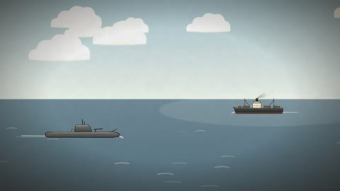
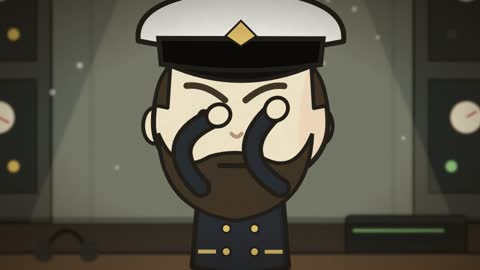

# `submarine_attack` (action)

**Use it when:** Submarine warfare: 'U-boats sank…', 'a torpedo struck…', 'unrestricted submarine warfare…'.

**Do NOT use it when:** —

**Camera (what the compiler does, per variant):** A: the U-boat surfaces/runs in the foreground, a torpedo wake runs to the freighter, the hit, smoke. B: the captain at the periscope (close), then the hit.

## Fields

| field | required | value | default | meaning |
|---|---|---|---|---|
| `side` | no | side name |  | whose submarine |
| `target` | no | side name |  | whose ship is hit |
| `hit_on` | no | words copied from this card's narration |  | word(s) of the torpedo hit |

Plus the common fields (`at`, `recipe`, `says`, `variant`, `date`, `place`, `name_card`, `label`, `counter`, `stamp`, `time`, `weather`, `tint`, …) — see [CATALOG.md](CATALOG.md#fields-every-card-can-have).

Variants: A, B (leave `variant` out: the compiler rotates them so the film never repeats a composition).

## Example card

```json
{
 "at": "U-boats sank",
 "recipe": "submarine_attack",
 "says": "German submarines began sinking merchant ships without warning.",
 "side": "german",
 "target": "british"
}
```

## Previews (middle frame of the example, each variant)

Variant A: 
Variant B: 
