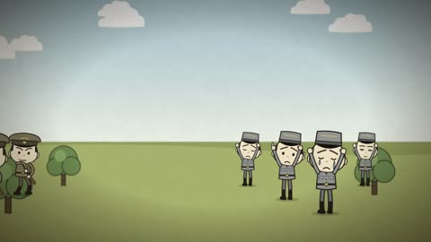
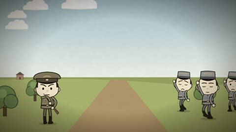

# `surrender` (action)

**Use it when:** Soldiers give up: 'thousands surrendered…', 'the army collapsed…', 'prisoners were taken…'.

**Do NOT use it when:** Leaders sign a surrender (signing).

**Camera (what the compiler does, per variant):** A: wide: hands go up one after another as the captors walk in → close on one face. B: a file of prisoners walking past the camera.

## Fields

| field | required | value | default | meaning |
|---|---|---|---|---|
| `side` | no | side name |  | who surrenders |
| `captors` | no | side name |  | who takes them prisoner |
| `count` | no | whole number | `4` | 3-6 men surrendering |

Plus the common fields (`at`, `recipe`, `says`, `variant`, `date`, `place`, `name_card`, `label`, `counter`, `stamp`, `time`, `weather`, `tint`, …) — see [CATALOG.md](CATALOG.md#fields-every-card-can-have).

Variants: A, B (leave `variant` out: the compiler rotates them so the film never repeats a composition).

## Example card

```json
{
 "at": "and smashed the Austro-Hungarian armies",
 "recipe": "surrender",
 "says": "The Austro-Hungarian army broke and its men surrendered in masses.",
 "side": "austrian",
 "captors": "russian"
}
```

## Previews (middle frame of the example, each variant)

Variant A: 
Variant B: 
