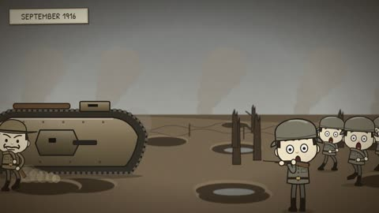
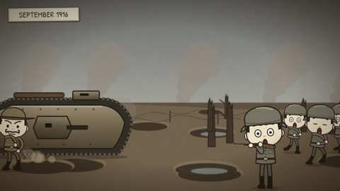

# `tank_attack` (action)

**Use it when:** Tanks break in: 'the first tanks…', 'the tanks broke through…', 'armour led the attack…'.

**Do NOT use it when:** Tanks just driving somewhere (convoy).

**Camera (what the compiler does, per variant):** A: wide ≥ 3 s as the tank crawls in and fires, defenders run → medium-close on the shocked defender. B: the defender's face first (he hears it), then the wide reveal.

## Fields

| field | required | value | default | meaning |
|---|---|---|---|---|
| `side` | no | side name |  | whose tanks |
| `enemy` | no | side name |  | the defenders who flee |
| `count` | no | whole number | `1` | 1-3 tanks |
| `shock_on` | no | words copied from this card's narration |  | word(s) where the defender's face is shown |
| `infantry` | no | true / false | `true` | infantry following the tanks |

Plus the common fields (`at`, `recipe`, `says`, `variant`, `date`, `place`, `name_card`, `label`, `counter`, `stamp`, `time`, `weather`, `tint`, …) — see [CATALOG.md](CATALOG.md#fields-every-card-can-have).

Variants: A, B (leave `variant` out: the compiler rotates them so the film never repeats a composition).

## Example card

```json
{
 "at": "In September, the first tanks",
 "recipe": "tank_attack",
 "says": "The British used tanks for the first time and the Germans fled.",
 "side": "british",
 "enemy": "german",
 "date": "SEPTEMBER 1916"
}
```

## Previews (middle frame of the example, each variant)

Variant A: 
Variant B: 
