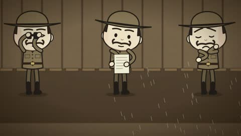
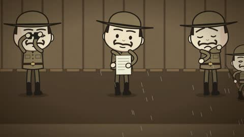

# `trench_wait` (action)

**Use it when:** Waiting, endurance, routine in the line: 'months of stalemate…', 'the war settled into the trenches…', 'the men waited…'.

**Do NOT use it when:** Shelling (under_fire).

**Camera (what the compiler does, per variant):** A: three men doing small things (one watches through binoculars, one writes, one smokes) → close on one. B: rain, a man trudging past the others.

## Fields

| field | required | value | default | meaning |
|---|---|---|---|---|
| `side` | no | side name |  | whose trench |
| `business` | no | one of `mixed`, `letters`, `lookout`, `rain`, `eating` | `"mixed"` | what they do |

Plus the common fields (`at`, `recipe`, `says`, `variant`, `date`, `place`, `name_card`, `label`, `counter`, `stamp`, `time`, `weather`, `tint`, …) — see [CATALOG.md](CATALOG.md#fields-every-card-can-have).

Variants: A, B (leave `variant` out: the compiler rotates them so the film never repeats a composition).

## Example card

```json
{
 "at": "The war settled into the trenches",
 "recipe": "trench_wait",
 "says": "Both armies dug in and the front froze for years.",
 "side": "british",
 "weather": "rain"
}
```

## Previews (middle frame of the example, each variant)

Variant A: 
Variant B: 
