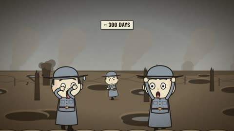
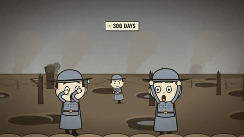

# `under_fire` (action)

**Use it when:** Men endure shelling or hold a position: 'the battle lasted 300 days…', 'they held the line…', 'the bombardment went on…'.

**Do NOT use it when:** They attack (assault/wave).

**Camera (what the compiler does, per variant):** A: wide over the men pressed down → medium-close on the most scared face. B: close first, then the wide with the runner.

## Fields

| field | required | value | default | meaning |
|---|---|---|---|---|
| `side` | no | side name |  | who is under fire |
| `setting` | no | one of `shellhole`, `trench` | `"shellhole"` | a shell hole in the open, or a trench |
| `runner` | no | true / false | `true` | a runner dashes across behind them |
| `shells` | no | whole number | `4` | bursts walking closer (2-6) |
| `fire_back` | no | true / false | `false` | one man fires back over the parapet |

Plus the common fields (`at`, `recipe`, `says`, `variant`, `date`, `place`, `name_card`, `label`, `counter`, `stamp`, `time`, `weather`, `tint`, …) — see [CATALOG.md](CATALOG.md#fields-every-card-can-have).

Variants: A, B (leave `variant` out: the compiler rotates them so the film never repeats a composition).

## Example card

```json
{
 "at": "It became the longest battle",
 "recipe": "under_fire",
 "says": "Verdun turned into a battle of endurance that lasted about 300 days.",
 "side": "french",
 "label": {
  "text": "≈ 300 DAYS",
  "on": "three hundred days"
 }
}
```

## Previews (middle frame of the example, each variant)

Variant A: 
Variant B: 
