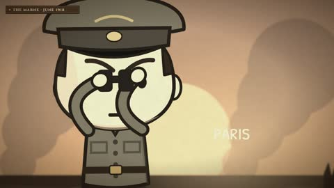
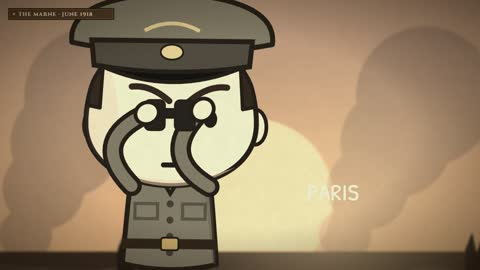

# `vista` (action)

**Use it when:** Men look toward a goal or a threat far away — the city they want, the land they lost, the fires on the horizon: 'they were within sight of Paris', 'they looked back at the burning city'. Dusk/dawn silhouettes on a ridge.

**Do NOT use it when:** Fighting (assault / wave).

**Camera (what the compiler does, per variant):** A: one wide of the ridge against the sky, slow push and drift. B (binoculars): the wide, then dissolve to a medium-close of the officer raising his binoculars.

## Fields

| field | required | value | default | meaning |
|---|---|---|---|---|
| `side` | no | side name |  | who stands on the ridge |
| `goal` | no | text | `""` | 1-2 words written small over the glow on the horizon, e.g. "PARIS" (optional) |
| `goal_on` | no | words copied from this card's narration |  | word(s) where the goal's name appears |
| `action` | no | one of `look`, `binoculars`, `turn_back`, `march_past` | `"look"` | look = they stand and stare; binoculars = an officer in front raises binoculars; turn_back = they turn and trudge away (failure); march_past = a column passes along the ridge |
| `count` | no | whole number | `4` | men on the ridge (2-7) |

Plus the common fields (`at`, `recipe`, `says`, `variant`, `date`, `place`, `name_card`, `label`, `counter`, `stamp`, `time`, `weather`, `tint`, …) — see [CATALOG.md](CATALOG.md#fields-every-card-can-have).

Variants: A, B (leave `variant` out: the compiler rotates them so the film never repeats a composition).

## Example card

```json
{
 "at": "In early June,",
 "recipe": "vista",
 "says": "In June German troops came within sight of Paris.",
 "side": "german",
 "goal": "PARIS",
 "goal_on": "Paris",
 "action": "binoculars",
 "time": "dusk",
 "tint": "warm",
 "place_id": "marne_ridge",
 "tag": "The Marne · June 1918"
}
```

## Previews (middle frame of the example, each variant)

Variant A: 
Variant B: 
