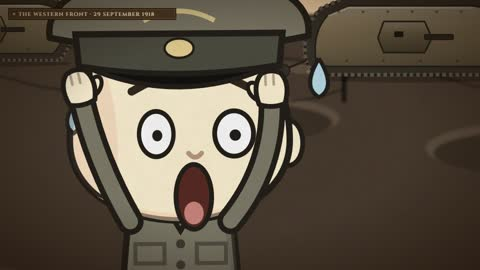
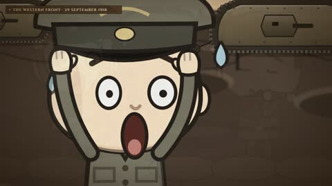

# `watch_front` (action)

**Use it when:** Soldiers at the front see what is coming or check the time / their chances: 'they could not hold for two hours', 'the enemy massed for the attack', 'by now the line was collapsing'. A face in front, the threat behind.

**Do NOT use it when:** The attack itself (wave / assault / tank_attack).

**Camera (what the compiler does, per variant):** A: medium on the two men behind the sandbags, the threat moving behind them → dissolve to a close-up on react_on. B: wide of the threat first, then the men.

## Fields

| field | required | value | default | meaning |
|---|---|---|---|---|
| `side` | no | side name |  | who is watching (in the foreground, behind sandbags) |
| `enemy` | no | side name |  | who is coming |
| `threat` | no | one of `tanks`, `infantry`, `planes`, `ships`, `smoke` | `"tanks"` | what is coming on the horizon |
| `business` | no | one of `watch`, `binoculars`, `aim`, `wait` | `"watch"` | what the man in front does (watch = checks his pocket watch) |
| `react_on` | no | words copied from this card's narration |  | word(s) where he gives up / panics (close-up) |
| `react` | no | one of `neutral`, `worried`, `determined`, `sad`, `shocked`, `angry`, `tired`, `smug`, `happy`, `panic` | `"panic"` | his reaction |

Plus the common fields (`at`, `recipe`, `says`, `variant`, `date`, `place`, `name_card`, `label`, `counter`, `stamp`, `time`, `weather`, `tint`, …) — see [CATALOG.md](CATALOG.md#fields-every-card-can-have).

Variants: A, B (leave `variant` out: the compiler rotates them so the film never repeats a composition).

## Example card

```json
{
 "at": "Not for weeks.",
 "recipe": "watch_front",
 "says": "The front could collapse within hours as enemy tanks roll forward.",
 "side": "german",
 "enemy": "british",
 "threat": "tanks",
 "business": "watch",
 "react_on": "For two hours",
 "time": "dawn",
 "tag": "The Western Front · 29 September 1918"
}
```

## Previews (middle frame of the example, each variant)

Variant A: 
Variant B: 
