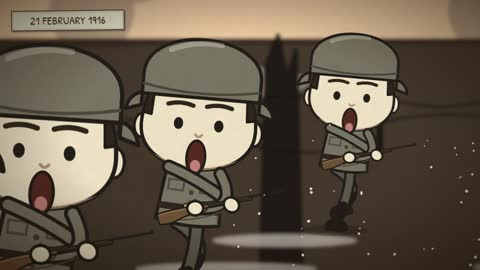
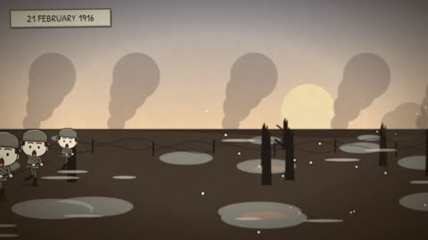

# `wave` (action)

**Use it when:** A fast charge or counter-attack across open ground: 'they stormed…', 'the attack began…', 'the Russians smashed through…'.

**Do NOT use it when:** A slow walk into machine guns (assault).

**Camera (what the compiler does, per variant):** A: wide as the wave crosses → full shot tracking the leader. B: start on the leader's face (shout), then the wide.

## Fields

| field | required | value | default | meaning |
|---|---|---|---|---|
| `side` | no | side name |  | who charges |
| `direction` | no | one of `right`, `left` | `"right"` | which way they run |
| `count` | no | whole number | `6` | 4-8 men |
| `falls` | no | whole number | `1` | 0-3 men hit |
| `hit_on` | no | words copied from this card's narration |  | word(s) for the first fall |
| `shells` | no | whole number | `3` | bursts ahead of them |
| `setting` | no | one of `nomansland`, `steppe`, `field`, `snow`, `desert`, `mud`, `ruins` | `"nomansland"` | terrain |
| `enemy` | no | side name |  | optional: defenders on the far side who fire, then break |

Plus the common fields (`at`, `recipe`, `says`, `variant`, `date`, `place`, `name_card`, `label`, `counter`, `stamp`, `time`, `weather`, `tint`, …) — see [CATALOG.md](CATALOG.md#fields-every-card-can-have).

Variants: A, B (leave `variant` out: the compiler rotates them so the film never repeats a composition).

## Example card

```json
{
 "at": "The attack began in February 1916",
 "recipe": "wave",
 "says": "German storm troops rushed the French lines at Verdun.",
 "side": "german",
 "date": "21 FEBRUARY 1916",
 "setting": "nomansland",
 "weather": "snow",
 "time": "dawn"
}
```

## Previews (middle frame of the example, each variant)

Variant A: 
Variant B: 
